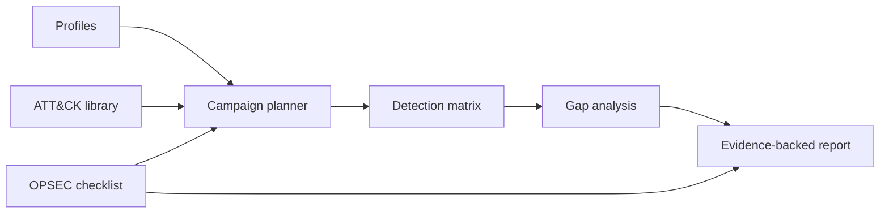

# RedTeamKit v3.1

> **Plan precisely. Validate detections honestly. Leave no ambiguity.**

[](https://github.com/kalikill666/redteamkit/actions/workflows/ci.yml)
[](https://www.python.org/)
[](#design-principles)
[](#authorized-use)

RedTeamKit is a local-first, stdlib-only engine for **authorized red-team planning, ATT&CK-informed simulation design, detection validation, OPSEC readiness, and evidence-based reporting**. It does not make network calls, does not fabricate findings, and keeps destructive techniques out of campaigns by default.

## See it in motion

Open the [interactive 3D showcase](https://kalikill666.github.io/redteamkit/showcase.html) for a live graph of the planning → execution → detection → reporting loop, animated captions, and a guided architecture tour.


## Why this repo feels different

- **Truthful by construction.** Reports require a real `--results` JSON file; missing evidence is not converted into a confident-looking number.
- **Safety is a default, not a footnote.** Destructive techniques are excluded unless scope and rollback are explicit.
- **Small attack surface.** The runtime uses Python's standard library and performs no network calls.
- **Useful at two speeds.** Inspect a profile in seconds, or generate a structured multi-phase campaign and detection appendix for a full engagement.
- **Readable outputs.** Plans, matrices, gap analysis, and reports are plain text/Markdown that fit into review workflows and source control.

## Install

### From a checkout

```bash
git clone https://github.com/kalikill666/redteamkit.git
cd redteamkit
python3 -m venv .venv
. .venv/bin/activate
python -m pip install --upgrade pip
python -m pip install -e .
```

### Without installing

The package has no runtime dependencies:

```bash
python3 -m redteamkit profiles
```

## Command guide

```bash
# Enumerate built-in adversary profiles
redteamkit profiles

# Inspect one profile
redteamkit profile APT29

# Build a 10-day campaign plan
redteamkit campaign --adversary FIN7 --days 10

# Prioritize techniques
redteamkit techniques --priority critical

# Inspect a technique matrix
redteamkit matrix T1566,T1003,T1021,T1059

# Start with a blank OPSEC checklist
redteamkit opsec

# Produce an evidence-backed report
redteamkit report --adversary APT29 --results examples/results.example.json
```

If you prefer module execution, every command also works as `python -m redteamkit <command>`.

## Evidence-backed reporting

The reporting command intentionally refuses to run without results. Use a file shaped like this:

```json
{
  "T1566": {"detected": true, "mttd": 12.5, "notes": "Email gateway alert"},
  "T1003": {"detected": false, "mttd": null, "notes": "No credential-access alert observed"},
  "T1021": {"detected": true, "mttd": 45.0, "notes": "Remote service alert"}
}
```

Then:

```bash
redteamkit report \
  --adversary APT29 \
  --results examples/results.example.json \
  > report.md
```

`mttd` is measured in minutes. Keep notes tied to actual evidence, detection IDs, timestamps, and analyst observations. Never use the example file as a client finding.

## Safety model

- **Authorized scope only:** obtain written permission, objectives, exclusions, contacts, and rollback criteria before planning.
- **No network activity:** RedTeamKit plans and measures; it does not scan, exploit, beacon, exfiltrate, or contact targets.
- **Destructive techniques stay out:** `T1486`, `T1490`, and `T1485` are excluded from campaigns by default.
- **Evidence over theater:** no synthetic detection rates or invented findings.
- **OPSEC begins blank:** a readiness score is meaningful only after the engagement team fills the checklist with real controls.

## Architecture



The core modules are intentionally separable:

| Module | Responsibility |
|---|---|
| `profiles` | APT28/29/41, FIN7, Lazarus, Turla, and custom profiles |
| `attack` | Technique library, tactics, data sources, detections, mitigations, priority |
| `campaign` | Multi-phase planner with tactic-aware TTP injection |
| `detection` | Validation matrix and detection-gap analysis |
| `opsec` | Blank checklist and readiness scoring |
| `reporting` | Executive summary, technical timeline, and detection appendix |
| `cli` | Human-friendly command-line interface |

## Development

```bash
python -m unittest -v
python -m compileall redteamkit
```

CI runs the untouched test suite on Python 3.9–3.13 and performs an installed-CLI smoke test. The repository layer is deliberately additive: the original package files and tests are preserved as released.

## Authorized use

RedTeamKit is for defensive security work performed with explicit authorization: red-team engagements, purple-team exercises, detection engineering, tabletop planning, and training labs. You are responsible for scope, safety, legal compliance, approvals, and handling of engagement data.

## License

No open-source license is currently granted. The repository is public for inspection and collaboration; all rights remain with the copyright holder unless a separate license is provided.
